<div align="center">

# Antigravity Account Switcher

**Every Antigravity account on one Windows desktop: the quota each one has left, and the switch made before you hit the wall.**

One portable `.exe`, no installer, no administrator rights.
Sign-ins stay in Windows Credential Manager; the only traffic is Google's own quota service, with each account's own sign-in.
When the account in use runs dry, it moves you to the one with the most left, and never from 2% to 1%.


[](LICENSE)

[Install](#install) · [The tour](#the-tour) · [Feature reference](#feature-reference) · [What it keeps](#what-it-keeps-and-where) · [Configuration](#configuration) · [Build from source](#building-from-source)

</div>

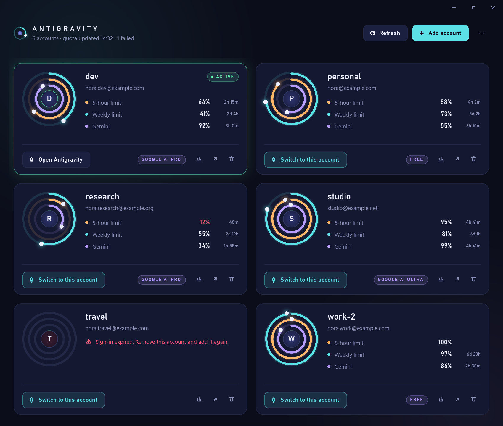

<div align="center"><em>Every screenshot here is the real app, with its own windows, tray menu and notices, driven by <code>tools/demo</code> with demonstration accounts and a pretend Google quota service.</em></div>

## Install

Windows 10 or 11 on x64, with Antigravity installed for the current user or in Program Files.
A release is `AntigravityAccountSwitcher-<version>.zip` with its SHA-256 in a `.sha256` file beside it.
Check the hash, unzip it anywhere, and run it:

```powershell
(Get-FileHash .\AntigravityAccountSwitcher-1.1.0.zip -Algorithm SHA256).Hash.ToLower()
Expand-Archive .\AntigravityAccountSwitcher-1.1.0.zip .\AntigravityAccountSwitcher
.\AntigravityAccountSwitcher\AntigravityAccountSwitcher.exe
```

That is the whole installation: the zip holds the executable, `LICENSE` and this README. To keep a
copy with a desktop shortcut and a Start-menu entry, choose **⋯ → Install on this PC** in the
window. Starting the app while it already runs brings up the running copy's window instead of a
second one.

Saved accounts belong to the PC, not to the executable: Windows protects them for your Windows
user, so a copy carried on a flash drive brings none along. Add each account once per PC.
Accounts saved by version 1.2 of the earlier switcher appear by themselves, and its account
shortcuts keep working.

<details>
<summary><strong>The command line, upgrading, and removing it</strong></summary>

| Command | What it does |
|---|---|
| `AntigravityAccountSwitcher.exe` | The window and the tray icon. A second start shows the running copy and exits |
| `AntigravityAccountSwitcher.exe --tray` | Starts in the tray, without the window (Start with Windows uses it); exits quietly if a copy already runs |
| `AntigravityAccountSwitcher.exe --launch <name>` | What an account's desktop shortcut runs: the small switch window only |

Only these exact forms count; the switch's letter case does not matter. Any other arguments open
the window.

**Upgrading.** Quit the running copy (tray → Quit), run the new executable, and choose
**⋯ → Update the installed copy**. It replaces the installed executable in place, so every
shortcut that points at it keeps working.

**Removing.** There is no uninstaller, because nothing is registered with Windows. Remove each
account in the window (that deletes its saved sign-in and its desktop shortcut), turn Start with
Windows off in Settings, Quit, then delete `%LOCALAPPDATA%\AntigravityAccountSwitcher`, the
desktop shortcut `Antigravity Account Switcher.lnk`, and the Start-menu folder
`Antigravity Account Switcher`. Antigravity's own sign-in stays as it is.

</details>

---

# The tour

## Every account's fuel, at a glance

Each saved account is a card with an **orbit gauge**: the outer orbit is the weekly limit, the
middle one the 5-hour limit, the inner one the lowest of the recommended Gemini models. Beside it
are the same three as percentages, each with the time left until it resets. A limit under 20%
turns red; a full one drops its countdown. The green ACTIVE tag goes to the account Antigravity is
signed in with right now, matched by the email in Antigravity's own credential rather than by
whatever the switcher did last. Every account's quota and plan are read once a minute, with the
window open or closed to the tray.

<div align="center">

<br>

</div>

## Every limit and every model, down to the minute it resets

**Quota details** slides in a drawer with everything Google reports for the account: each group of
limits, named as Google names it, and every model Antigravity offers, in Antigravity's own order.
Each line carries the countdown and the local time it resets: `2h 15m · 16:47` today, or
`3d 4h · Fri 27 Nov 18:32` on another day. Models that share a display name are merged and keep the
tighter number; internal models are left out.

<div align="center">
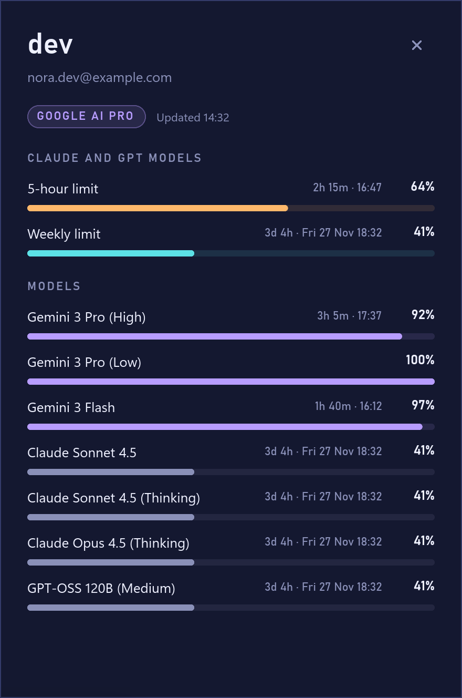
</div>

## Adding an account notices the sign-in, and undoes itself if you stop

Give the account a short name (1 to 40 English letters, digits or hyphens, starting with a letter
or digit; it also names the desktop shortcut). If Antigravity is open, the switcher asks to close it first. Then it sets the
current sign-in aside, clears it, starts Antigravity, and checks every 2 seconds for the new
sign-in, showing its email the moment it lands. **Save** copies it, reads the copy back to confirm
it is there, and creates the desktop shortcut. **Cancel, a failure, or Quit in the middle puts the
previous sign-in back**, or signs Antigravity out again if there was none.

| 1. Name it | 2. Close Antigravity |
|---|---|
| 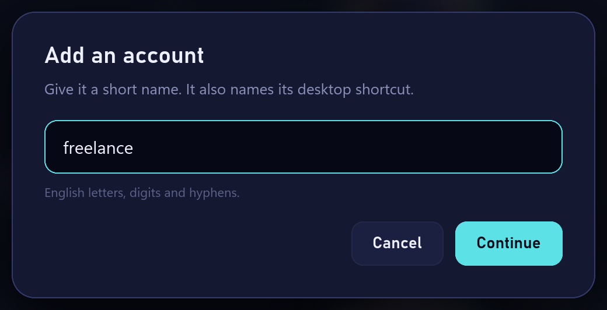 | 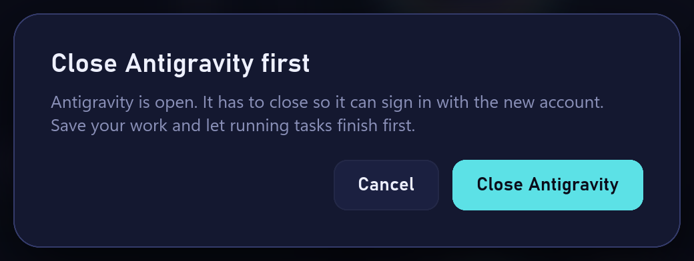 |
| **3. Sign in** | **4. Noticed** |
| 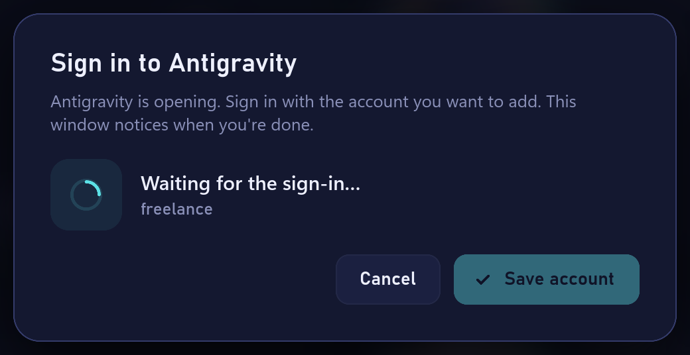 |  |

<div align="center">

</div>

## Switching asks before it closes anything

With Antigravity closed, **Switch to this account** signs it in as that account and starts it.
With Antigravity open, the switcher asks first, because Antigravity has to restart to change
accounts. It then asks Antigravity to close, waits up to 8 seconds, ends whatever is left, waits up
to 8 more, and changes the sign-in only once nothing runs; if Antigravity still will not close, it
says so and changes nothing. The sign-in is copied whole: no field in it is ever edited. Opening
the account that is already signed in just starts Antigravity, keeping the tokens Antigravity has
refreshed since the account was saved. The slow parts run off the UI thread, so the window never
freezes.

<div align="center">

<br>
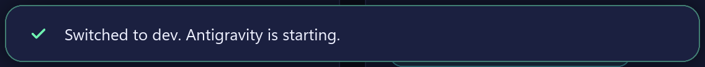
</div>

## A desktop shortcut for every account

Every saved account gets `Antigravity - <name>.lnk` on the desktop, with Antigravity's icon. It
runs `--launch <name>`, which opens a small window instead of the app: it asks first when
Antigravity is open, switches, and reports a problem in words if there is one. The shortcut of the
account already in use starts Antigravity when it is closed and does nothing when it runs.
Shortcuts made after **Install on this PC** point at the installed copy.

| Antigravity is open | The account is gone |
|---|---|
|  | 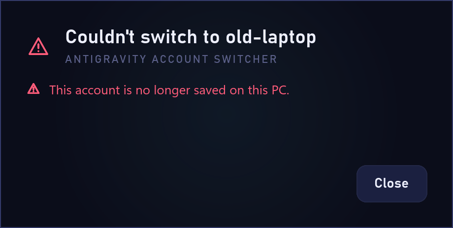 |

## It lives in the tray

Closing the window (its × button, Alt+F4, or the taskbar) keeps the app running in the tray, and
the first time a notice says so. The tray menu lists every account with its 5-hour and weekly
quota, the active one marked with a dot; picking one is the same as its card's Switch button, and
the window opens only if a question has to be asked. The icon's tooltip carries the active
account's numbers; a left click opens the window. Only one copy runs per Windows user.

| The tray menu | The first close |
|---|---|
| 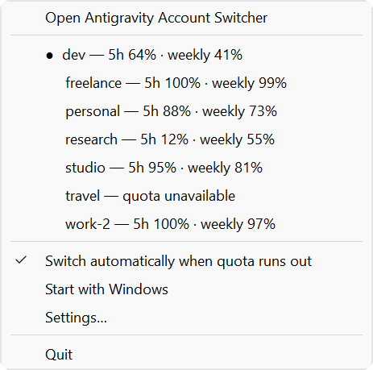 | 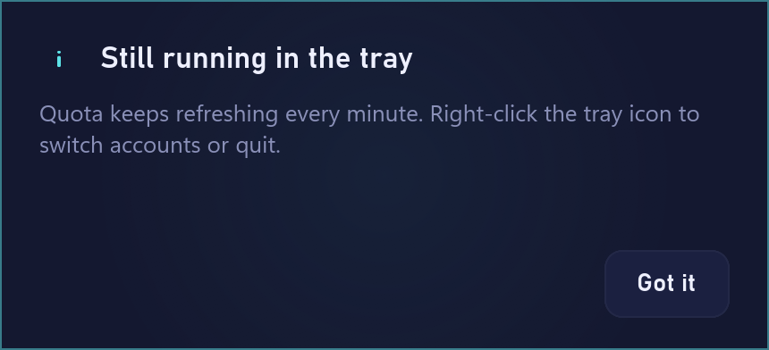 |

## It switches for you, but never from 2% to 1%

After every complete reading, the switcher looks at the account in use. If its 5-hour or weekly
limit is at or below the threshold (5% by default), it moves to the account with the most left,
judged by the tighter of that account's two limits, with more weekly quota breaking a tie. Any
account at or below the threshold counts as empty, so an almost-empty account is never a target,
and neither is one whose quota failed or is still loading. With Antigravity open, a notice in the
corner counts down first:

<div align="center">
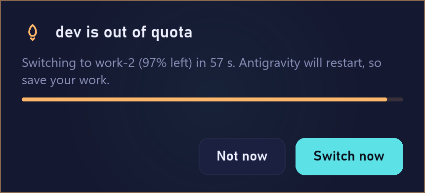
</div>

**Not now** leaves that account alone until it refills or another account becomes active. With
Antigravity closed, only the sign-in changes, ready for Antigravity's next start. When every
account is empty, one notice says which refills first. After any switch, nothing is decided again
until a full reading taken after it.

| Antigravity was closed | Nothing left anywhere |
|---|---|
|  | 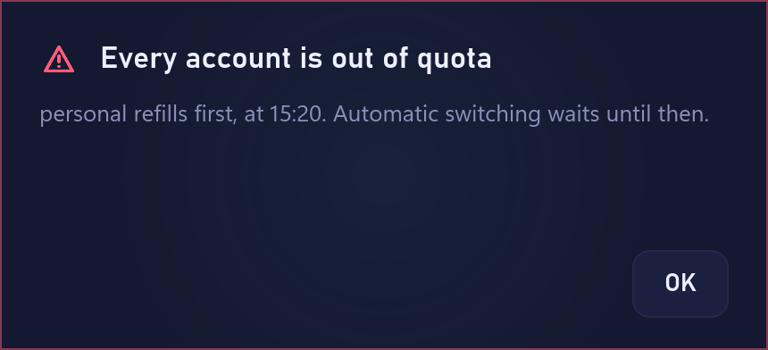 |

The threshold, the countdown and Start with Windows are in **Settings**, from the ⋯ menu or the
tray menu. Every change is saved at once.

<div align="center">

</div>

## Problems are named, with what to do about them

A card that cannot be read says why and what to do, in a sentence, rather than showing a code:
an expired sign-in, a refused sign-in, no connection or proxy, Google's quota service answering
with an error, or Antigravity's sign-in client missing because Antigravity is not installed.
Removing an account forgets only the switcher's copy of its sign-in and its desktop shortcut.

<div align="center">

<br>
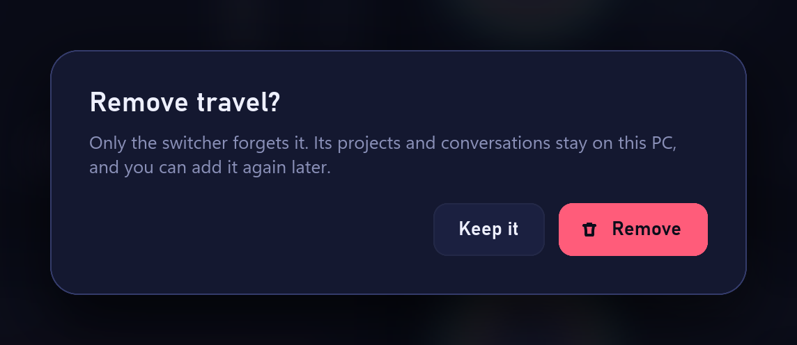
</div>

## The first start, the ⋯ menu and the help

The first start has nothing to show, and says what to do next:

<div align="center">
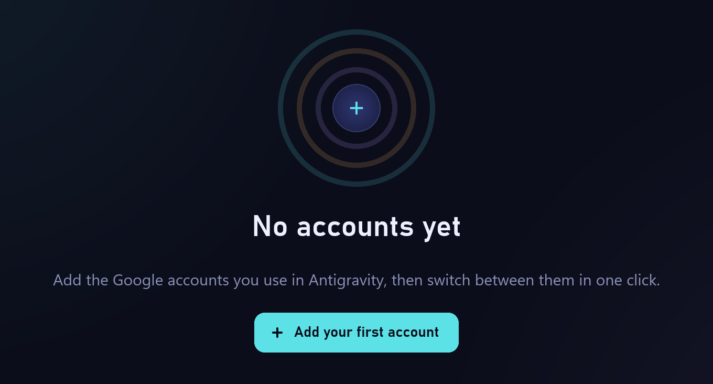
</div>

| The ⋯ menu | About |
|---|---|
| 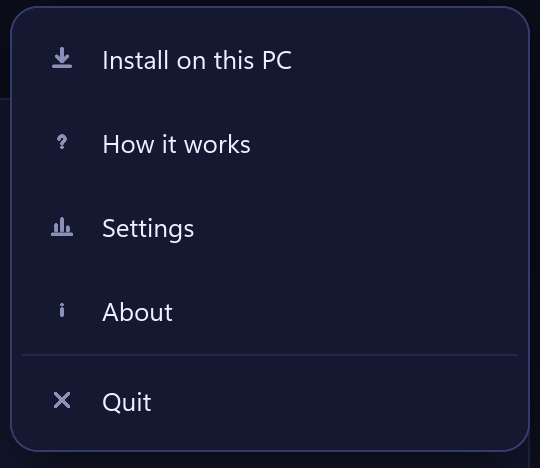 |  |

<details>
<summary><strong>How it works, as the app explains it</strong></summary>

<div align="center">
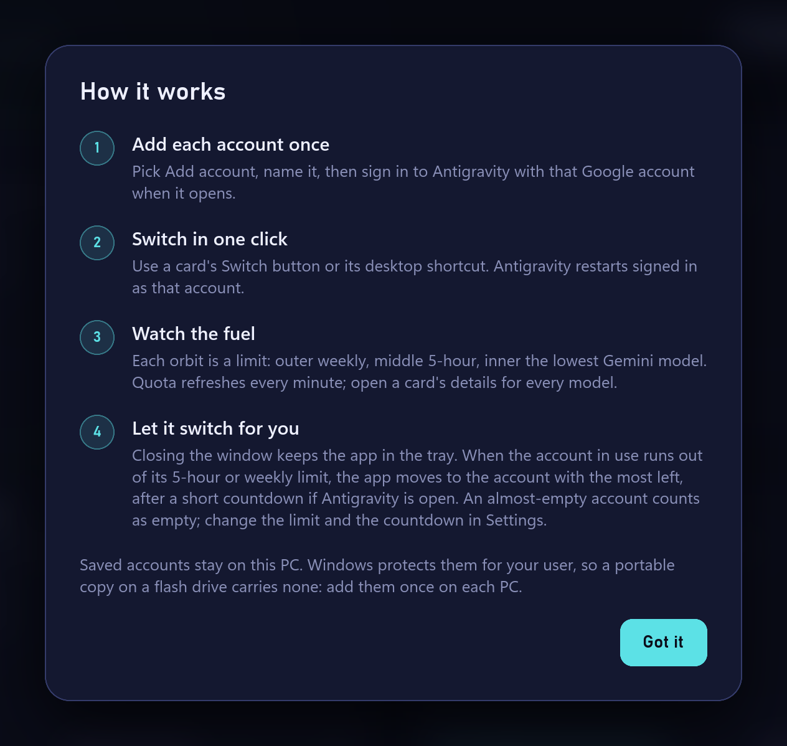
</div>

</details>

---

# Feature reference

| | |
|---|---|
| **Accounts** | A card per account with an orbit gauge (weekly · 5-hour · lowest recommended Gemini model) · percent and reset countdown per limit · red under 20% · ACTIVE by the email Antigravity is signed in with · plan from Google · problems in words on the card · a grid that reflows with the window, narrow cards shortening their button and plan tag · double-click a card to switch |
| **Quota** | Every account once a minute, window open or in the tray · Refresh on demand · every limit group and every model in a details drawer, in Antigravity's order · countdowns and local reset times · access tokens kept in memory and renewed 2 minutes early · Antigravity's own sign-in client found in its install, cached encrypted, looked for again while missing · the Windows proxy settings, including PAC scripts and automatic detection |
| **Switching** | One click, or a double-click on the card · asks before closing an open Antigravity · close request, then ending its processes, 8 s each · the credential copied whole, never edited · the active account just starts Antigravity · nothing blocks the window |
| **Adding** | Guided: name → close Antigravity → sign in → save · the new sign-in noticed every 2 s, with its email · the saved copy read back · desktop shortcut created · Cancel, a failure or Quit restores the previous sign-in |
| **Shortcuts** | `Antigravity - <name>.lnk` per account, with Antigravity's icon · `--launch <name>` window that asks, switches and reports · aimed at the installed copy when there is one · removed with the account |
| **Tray** | Closing keeps it running · every account's 5-hour and weekly quota in the menu · pick an account to switch · automatic switching and Start with Windows as check items · Settings and Quit · the active account's quota in the tooltip · one running copy per Windows user |
| **Automatic switching** | Threshold 1–50% (5%) on the 5-hour and weekly limits · the most-left account as target, unknown quota never one · countdown notice 0–600 s (60 s) with Switch now and Not now · a quiet sign-in change when Antigravity is closed · one notice with the earliest refill when every account is empty · waits for a fresh reading after each switch |
| **Install** | A portable single executable · Install on this PC: a copy in `%LOCALAPPDATA%`, desktop and Start-menu shortcuts · Update the installed copy · Start with Windows, in the tray |
| **Privacy and safety** | Sign-ins only in Windows Credential Manager · only Google's token and quota endpoints contacted · a log that never holds a token · no administrator rights · removing an account never touches projects or conversations |
| **Compatibility** | The saved accounts, account shortcuts, install folder and sign-in client cache of version 1.2 of the earlier switcher keep working |
| **Interface** | A dark theme of its own · frameless window with the Windows 11 shadow and rounded corners · English, with every sentence ready for translation · labels for screen readers and UI Automation on every control |

---

## What it keeps, and where

| Where | What |
|---|---|
| Credential Manager, `antigravity-switcher:<name>` | A saved account: a copy of Antigravity's sign-in, as Antigravity wrote it |
| Credential Manager, `antigravity-switcher:setup-rollback` | The previous sign-in, only while an account is being added |
| Credential Manager, `gemini:antigravity` | Antigravity's own sign-in; the switcher copies into it and never edits it |
| `%LOCALAPPDATA%\AntigravityAccountSwitcher\settings.json` | Settings |
| `%LOCALAPPDATA%\AntigravityAccountSwitcher\oauth-client.bin` | Antigravity's sign-in client, encrypted with DPAPI for your Windows user |
| `%LOCALAPPDATA%\AntigravityAccountSwitcher\logs\app.log` | A diagnostic log, moved to `app.1.log` at start once it passes 1 MiB |
| `%LOCALAPPDATA%\AntigravityAccountSwitcher\AntigravityAccountSwitcher.exe` | The installed copy, after **Install on this PC** |
| Desktop, `Antigravity - <name>.lnk` | An account's shortcut |
| Desktop and Start menu, `Antigravity Account Switcher.lnk` | The app, after **Install on this PC** |
| Startup folder, `Antigravity Account Switcher.lnk` | Start with Windows, running `--tray` |

**Network.** A saved refresh token is exchanged at `oauth2.googleapis.com` for an access token,
using the installed-app sign-in client that ships inside Antigravity: the switcher finds it by
scanning Antigravity's language server and caches it, because Google issues it to Antigravity, not
to this tool. Quota comes from `cloudcode-pa.googleapis.com` (`loadCodeAssist`,
`retrieveUserQuotaSummary`, `fetchAvailableModels`). Both go through the Windows proxy settings:
the manual proxy and its bypass list, a PAC script, or automatic detection, remembered per host
for 5 minutes. Each request may take 25 seconds; a refused access token is renewed and retried
once. Nothing else is contacted.

**Privileges.** The app runs as the signed-in user (`asInvoker`) and reads no environment
variables. The log never receives a token: secret values are a type that prints as `***`.
See [SECURITY.md](SECURITY.md) to report a problem.

## Configuration

Everything is set in the window or the tray and saved at once to `settings.json`:

| Setting | Key | Default | Range |
|---|---|---|---|
| Switch automatically when quota runs out | `autoSwitch` | `true` | on or off |
| Counts as out of quota at | `emptyAtPercent` | `5` | 1–50 (%) |
| Warning before Antigravity restarts | `warningSeconds` | `60` | 0–600 s, in 15 s steps in the window; 0 switches without a warning |
| (the first close-to-tray notice was shown) | `trayHintShown` | `false` | |

A missing or unreadable file means the defaults; a value out of range is clamped to it. Start with
Windows is not a key: it is the shortcut in the Startup folder itself. There are no environment variables. Endpoints, timings and credential names are
constants in each crate's settings struct, so tests can point them elsewhere.

## Building from source

Install Rust with [rustup](https://rustup.rs). The toolchain is pinned to 1.100.0 with the MSVC
target in `rust-toolchain.toml`, and rustup fetches it on the first build. The C runtime is linked
statically (`.cargo/config.toml`), which is why the executable needs nothing installed beside it.

```powershell
cargo build --release      # target\release\AntigravityAccountSwitcher.exe
cargo xtask dist           # dist\AntigravityAccountSwitcher-<version>.zip and its .sha256
```

`cargo xtask dist` packs the executable, `LICENSE` and `README.md` from the repository root.

### Running the tests

```powershell
cargo install cargo-binstall
cargo binstall cargo-nextest cargo-llvm-cov cargo-deny cargo-machete
cargo xtask check
```

`cargo xtask check` is the gate, and stops at the first failure: formatting, Clippy (pedantic, with
warnings as errors), licenses and advisories, unused dependencies, a rule that no app crate reads an
environment variable, then every test under coverage, with at least 95% of lines covered outside
the UI crate. Every Windows boundary is a trait with a Windows adapter and an in-memory fake that
pass the same contract tests. Tests that touch the real Credential Manager use throw-away names (a
scoped store refuses any other name) and run one at a time (`.config/nextest.toml`), because
Credential Manager can lose a write when several processes write at the same moment.

### Screenshots

Every image in this README is retaken with one command:

```powershell
python tools/demo/demo.py                        # build, run every session, write docs/screenshots
python tools/demo/demo.py --only 04-details      # only these shots
python tools/demo/demo.py serve accounts         # open a session's window to look around
python tools/demo/demo.py reset                  # forget the sessions' state
```

It copies the working tree into `.demo/code`, builds the `demo` example there, starts a pretend
Google quota service that answers from `tools/demo/accounts.json`, and plays the sessions of
`tools/demo/shots.json`. The example (`crates/app/examples/demo.rs`) is the real controller, windows
and tray icon, clicked through their own buttons, over pretend Windows parts: credentials in
memory, a pretend Antigravity, shortcuts that are only recorded, and every folder under
`.demo/sessions`. Nothing real on the PC is read or changed; the windows appear on screen while it
runs, and the tray-menu shot moves the pointer for a moment and puts it back. It needs Python 3.11
with Pillow, and is sharpest on a screen that fits the window at twice its size.

`cargo run -p app --example snapshot -- out.png <scene>` renders a single screen with made-up data,
for design work.

## Layout

```
crates/kernel        clock, known folders, secret values, lenient JSON, the log
crates/vault         Windows Credential Manager and the sign-in JSON
crates/antigravity   finding, closing and starting Antigravity
crates/desktop       shortcuts, the installed copy, settings, Start with Windows, one running copy
crates/accounts      saved accounts, switching, and the add flow with its rollback
crates/quota         sign-in client, tokens, Google's quota API, the Windows proxy, the switch decision
crates/app           the Slint UI (ui/), the controller, the tray, the shortcut window, the composition root
crates/app/examples  demo (this README's screenshots) and snapshot (one screen with made-up data)
xtask                the gate and the release zip
tools/demo           the screenshot driver, the pretend Google service, its accounts and the shot list
docs/screenshots     the images in this README
```

The crate graph is the boundary: one crate per module, and only `app` knows them all.

## License

[MIT](LICENSE). The interface is built with [Slint](https://slint.dev) under its royalty-free
license (see the About panel). An independent tool, not affiliated with Google.
