<div align="center">

# Antigravity Account Switcher

**Every Antigravity account on one Windows desktop: the quota each one has left, and the switch made before you hit the wall.**

An installer or one portable `.exe`, no administrator rights.
Sign-ins stay in Windows Credential Manager; the only traffic is Google's own quota service and this project's GitHub releases.
When the account in use runs dry, it moves you to the one with the most left, and never from 2% to 1%.

[](https://github.com/DrSaeedHub/pro-antigravity-manager/releases)
[](https://github.com/DrSaeedHub/pro-antigravity-manager/releases)
[](https://github.com/DrSaeedHub/pro-antigravity-manager/actions/workflows/ci.yml)
[](LICENSE)


[Install](#install) · [The tour](#the-tour) · [Feature reference](#feature-reference) · [What it keeps](#what-it-keeps-and-where) · [Configuration](#configuration) · [Build from source](#building-from-source) · [Releasing](#releasing)

</div>


<div align="center"><em>Every screenshot here is the real app, with its own windows, tray menu and notices, driven by <code>tools/demo</code> with demonstration accounts, a pretend Google quota service and a pretend release feed.</em></div>

## Install

Windows 10 or 11 on x64, with Antigravity installed. Every
[release](https://github.com/DrSaeedHub/pro-antigravity-manager/releases/latest) has two ways in:

| File | What it is |
|---|---|
| `AntigravityAccountSwitcher-<version>-setup.exe` | **The installer.** Installs for your Windows user, with no administrator rights, into `%LOCALAPPDATA%\AntigravityAccountSwitcher`; adds a Start menu entry, a desktop shortcut and, if you tick it, Start with Windows; lists the app in Installed apps; opens it at the end |
| `AntigravityAccountSwitcher-<version>-portable.zip` | **Portable.** The executable, `LICENSE` and this README. Unzip it anywhere and run `AntigravityAccountSwitcher.exe` |

The executables are not code-signed, so the first time Windows SmartScreen may say it does not
recognise the app: **More info → Run anyway**. `SHA256SUMS.txt` in the release has the hash of
each file:

```powershell
(Get-FileHash .\AntigravityAccountSwitcher-<version>-setup.exe -Algorithm SHA256).Hash.ToLower()
```

From then on the app keeps itself up to date: it looks for a new release every minute and, when
you choose **Update**, installs it and restarts on it ([how](#updates-in-one-click-checked-before-they-run)).

Saved accounts belong to the PC, not to the executable: Windows protects them for your Windows
user, so a copy carried on a flash drive brings none along. Add each account once per PC.
Accounts saved by version 1.2 of the earlier switcher appear by themselves, and its account
shortcuts keep working.

<details>
<summary><strong>The command line, a silent install, and removing it</strong></summary>

| Command | What it does |
|---|---|
| `AntigravityAccountSwitcher.exe` | The window and the tray icon. A second start brings the running copy's window back (restored, in front) and exits |
| `AntigravityAccountSwitcher.exe --tray` | Starts in the tray, without the window (Start with Windows uses it); exits quietly if a copy already runs |
| `AntigravityAccountSwitcher.exe --launch <name>` | What an account's desktop shortcut runs: the small switch window only |
| `AntigravityAccountSwitcher.exe --version` | Prints the version and exits (the updater asks a downloaded copy this before trusting it) |
| `AntigravityAccountSwitcher.exe --updated <old version>` | How the previous version starts the new one after an update: the window opens and says it updated |
| `AntigravityAccountSwitcher.exe --uninstall-dialog` | The window the uninstaller opens; its answer is the exit code (0 keep, 20 remove, +1 also the saved accounts, +2 also settings and logs) |
| `AntigravityAccountSwitcher.exe --uninstall [--delete-accounts]` | What the uninstaller runs: removes every saved account's desktop shortcut and the Start with Windows shortcut, and with `--delete-accounts` the saved accounts too |

Only these exact forms count; the switch's letter case does not matter. Any other arguments open
the window.

**A silent install.** The installer is Inno Setup, so its usual switches work:
`AntigravityAccountSwitcher-<version>-setup.exe /VERYSILENT /SUPPRESSMSGBOXES /MERGETASKS="startup"`
(tasks: `desktopicon`, on by default, and `startup`). It asks a running copy to quit first, through
the same channel a second start uses to show the window, and closes a copy too old to listen.

**Without the installer.** A portable copy can install itself: **⋯ → Install on this PC** copies
it to the same folder the installer uses, with desktop and Start-menu shortcuts. Both kinds of
copy update themselves the same way.

**Removing.** If you used the installer, uninstall it from Installed apps. Instead of Windows'
bare "Are you sure" box, the app's own window says what goes (the app, its shortcuts, every
account's desktop shortcut and Start with Windows) and what stays (Antigravity and the account it
is signed in with), with two switches that are off unless you turn them on: also delete the saved
accounts, and also delete settings and logs. A scripted uninstall asks nothing and keeps both:
`unins000.exe /VERYSILENT`, adding `/DELETEACCOUNTS` and `/DELETESETTINGS` to delete them. A
portable copy is removed by hand: remove the accounts in the window, turn Start with Windows off in
Settings, Quit, and delete the folder and the shortcuts.

<div align="center">
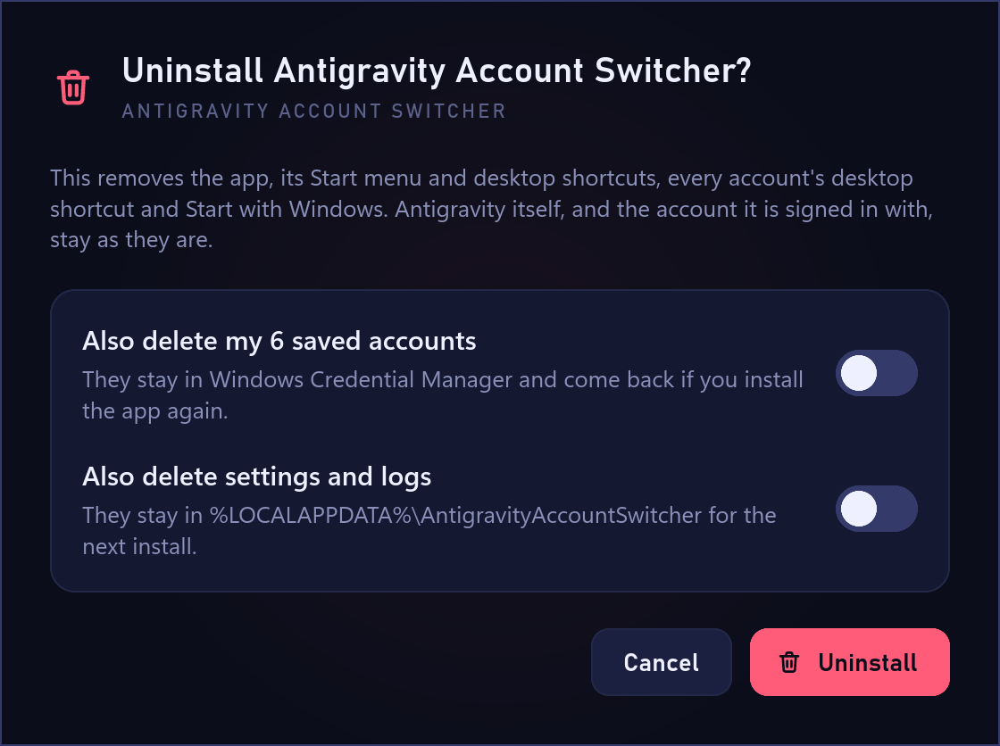
</div>

</details>

---

# The tour

## Every account's fuel, at a glance

Google gives every account two groups of limits, the same ones Antigravity shows in its settings:
**Claude and GPT** models, and **Gemini** models, each with a 5-hour and a weekly limit. Each saved
account is a card with an **orbit gauge**, one orbit per limit, from the outside in: Claude and GPT
weekly, Claude and GPT 5-hour, Gemini weekly, Gemini 5-hour. Beside it a small table gives the same
four as percentages, each with the time left until it refills; a coloured dot ties each number to
its orbit (5-hour limits warm, weekly ones cool). The details drawer lists both groups and every
model. A limit under 20% turns red; a full one drops its countdown. The green ACTIVE tag goes to the account Antigravity is
signed in with right now, matched by the email in Antigravity's own credential rather than by
whatever the switcher did last. Every account's quota and plan are read once a minute, with the
window open or closed to the tray.

<div align="center">
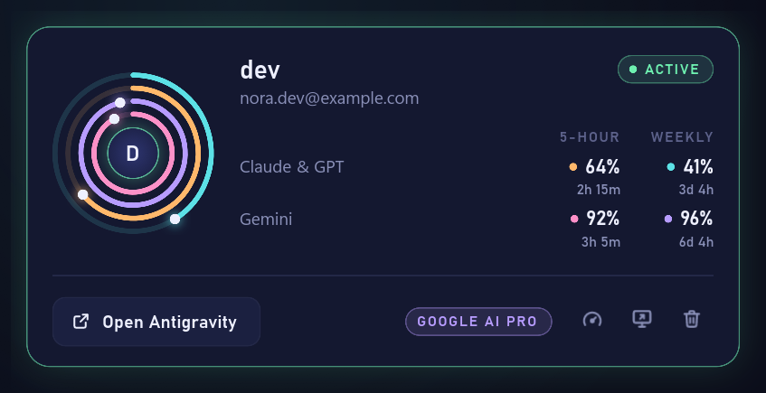
<br>
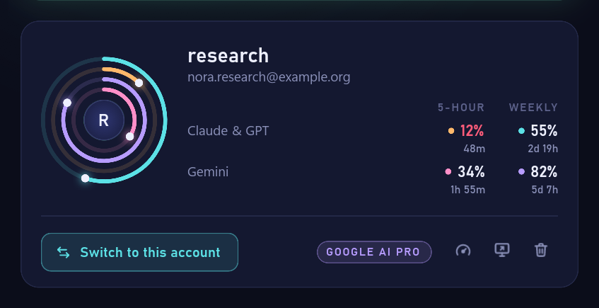
</div>

## Every limit and every model, down to the minute it resets

**Quota details** slides in a drawer with everything Google reports for the account: each group of
limits, named as Google names it, and every model Antigravity offers, in Antigravity's own order.
Each line carries the countdown and the local time it resets: `2h 15m · 16:47` today, or
`3d 4h · Fri 27 Nov 18:32` on another day. Models that share a display name are merged and keep the
tighter number; internal models are left out.

<div align="center">

</div>

## Adding an account notices the sign-in, and undoes itself if you stop

Give the account a short name (1 to 40 English letters, digits or hyphens, starting with a letter
or digit; it also names the desktop shortcut). If Antigravity is open, the switcher asks to close
it first. Then it sets the current sign-in aside, clears it, starts Antigravity, and checks every
2 seconds for the new sign-in, showing its email the moment it lands. **Save** copies it, reads the
copy back to confirm it is there, and creates the desktop shortcut. **Cancel, a failure, or Quit in
the middle puts the previous sign-in back**, or signs Antigravity out again if there was none.

| 1. Name it | 2. Close Antigravity |
|---|---|
|  |  |
| **3. Sign in** | **4. Noticed** |
|  | 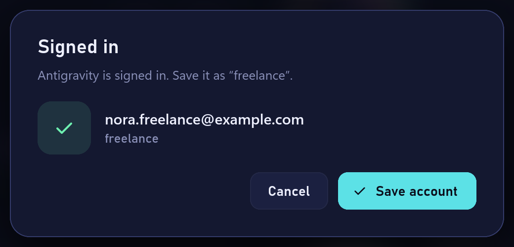 |

<div align="center">

</div>

## Switching asks before it closes anything

With Antigravity closed, **Switch to this account** signs it in as that account and starts it.
With Antigravity open, the switcher asks first, because Antigravity has to restart to change
accounts. It then asks Antigravity to close, waits up to 8 seconds, ends whatever is left, waits up
to 8 more, and changes the sign-in only once nothing runs; if Antigravity still will not close, it
says so and changes nothing. The sign-in is copied whole: no field in it is ever edited. Opening
the account that is already signed in just starts Antigravity, keeping the tokens Antigravity has
refreshed since the account was saved. The slow parts run off the UI thread, so the window never
freezes.

<div align="center">
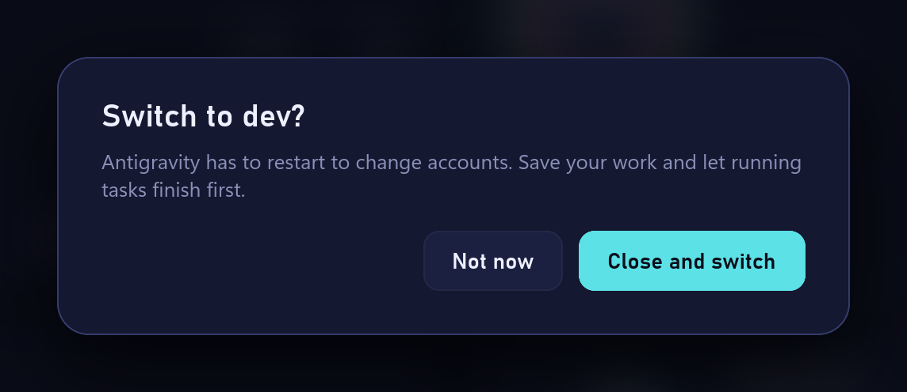
<br>

</div>

## A desktop shortcut for every account

Every saved account gets `Antigravity - <name>.lnk` on the desktop, with Antigravity's icon. It
runs `--launch <name>`, which opens a small window instead of the app: it asks first when
Antigravity is open, switches, and reports a problem in words if there is one. The shortcut of the
account already in use starts Antigravity when it is closed and does nothing when it runs.
Shortcuts point at the installed copy when there is one.

| Antigravity is open | The account is gone |
|---|---|
| 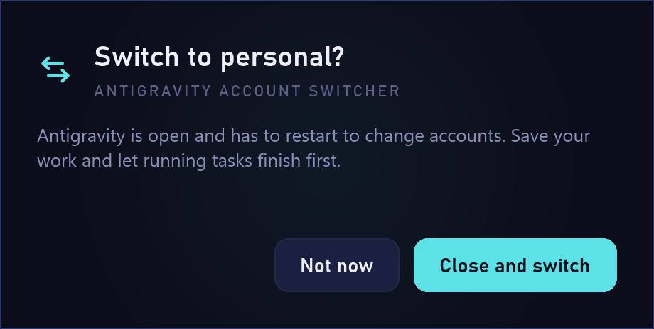 |  |

## It lives in the tray

Closing the window (its × button, Alt+F4, or the taskbar) keeps the app running in the tray, and
the first time a notice says so. The tray menu lists every account with what is left of Claude and
GPT and of Gemini (each group's tighter limit), the active one marked with a dot; picking one is the same as its card's Switch button, and
the window opens only if a question has to be asked. A new version, the GitHub page, Settings and
Quit are there too. The icon's tooltip carries the active account's numbers; a left click opens
the window. **Only one copy runs per Windows user**: opening the app again brings the running
copy's window back, restored and in front, even from the tray. Windows can leave a copy hanging
while it closes, still holding the single-copy lock; the next start sees that its process is
ending and takes over instead of starting beside it.

| The tray menu | The first close |
|---|---|
|  |  |

## It switches for you, but never from 2% to 1%

After every complete reading, the switcher looks at the account in use. If a 5-hour or weekly
limit of one of its groups is at or below the threshold (5% by default), it moves to the account
with the most left **in that group**: a group only runs down while its models are used, so the
group that ran out is the one you need. Most left means the tighter of that group's two limits,
then the most of everything else, then more weekly quota. An account at or below the threshold in
that group counts as empty, so an almost-empty account is never a target, and neither is one whose
quota failed or is still loading. With Antigravity open, a notice in the
corner counts down first:

<div align="center">

</div>

**Not now** leaves that account alone until it refills or another account becomes active. With
Antigravity closed, only the sign-in changes, ready for Antigravity's next start. When every
account is empty, one notice says which refills first. After any switch, nothing is decided again
until a full reading taken after it.

| Antigravity was closed | Nothing left anywhere |
|---|---|
| 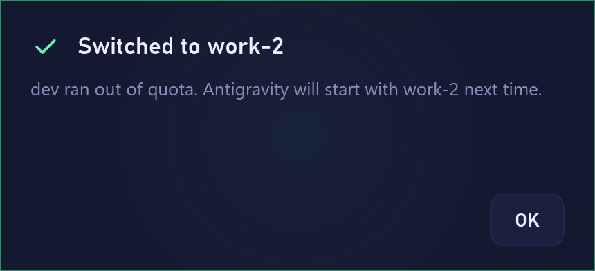 |  |

The threshold, the countdown, Start with Windows and the update checks are in **Settings**, from
the ⋯ menu or the tray menu. Every change is saved at once.

<div align="center">
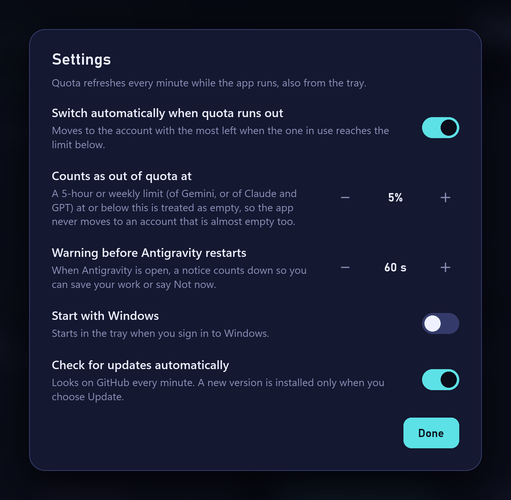
</div>

## Updates in one click, checked before they run

The app reads this repository's newest release every minute, with the window open or in the tray,
from `releases/latest/download/latest.json`: a small manifest the release workflow writes, served
by GitHub's download network rather than its rate-limited API. A newer version appears as an
**Update** button at the top, as an item in the tray menu and in About; while the window is hidden
it is announced once, in the corner. Nothing is installed until you choose it.

<div align="center">
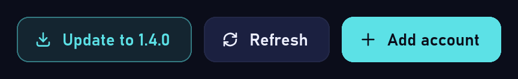
</div>

One click downloads the portable package next to the running executable, with progress and
**Cancel**. **Before anything is replaced**, the download must come from this repository over
HTTPS, match the size and SHA-256 in the manifest, and the executable inside it must start and
report the version it was offered. Then the running file is renamed aside (Windows lets a running
program be renamed, not overwritten), the new one takes its name, and the app restarts on it and
says so; the old file is deleted on that start. A copy that cannot write its own folder says so and
offers the download page instead. **An installed copy then brings its installation along**: it
downloads that version's installer, runs it without a window and opens again, so its uninstaller
and its entry in Installed apps always match the app. Prereleases are never offered.

| About, with the new version | Updating |
|---|---|
| 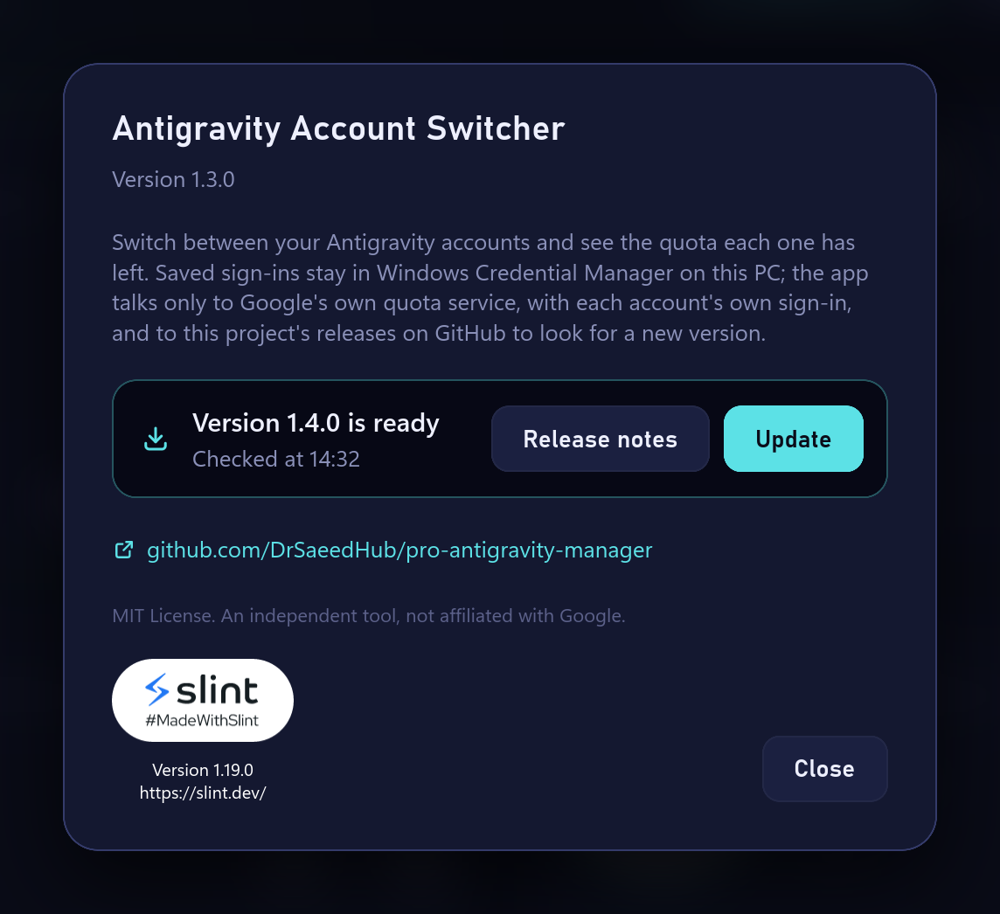 | 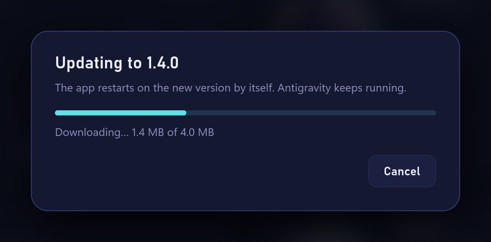 |

<div align="center">
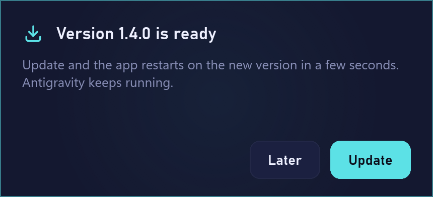
</div>

## Problems are named, with what to do about them

A card that cannot be read says why and what to do, in a sentence, rather than showing a code:
an expired sign-in, a refused sign-in, no connection or proxy, Google's quota service answering
with an error, or Antigravity's sign-in client missing because Antigravity is not installed.
Removing an account forgets only the switcher's copy of its sign-in and its desktop shortcut.

<div align="center">
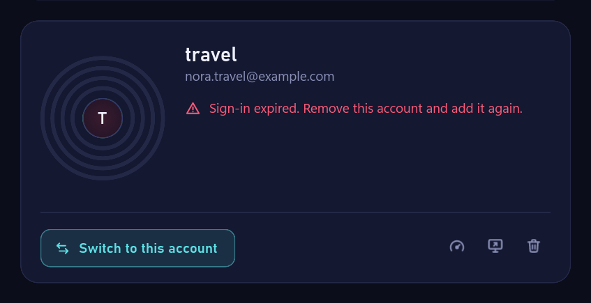
<br>

</div>

## The first start, the ⋯ menu and the help

The first start has nothing to show, and says what to do next:

<div align="center">

</div>

| The ⋯ menu | How it works |
|---|---|
|  |  |

---

# Feature reference

| | |
|---|---|
| **Accounts** | A card per account with an orbit gauge and a table of its four limits (Claude and GPT, Gemini · 5-hour, weekly) · percent and refill countdown per limit · red under 20% · ACTIVE by the email Antigravity is signed in with · plan from Google · problems in words on the card · a grid that reflows with the window and never squeezes a card below the width its content needs · a scroll bar when the cards do not all fit · double-click a card to switch |
| **Quota** | Every account once a minute, window open or in the tray · Refresh on demand · every limit group and every model in a details drawer, in Antigravity's order · countdowns and local reset times · access tokens kept in memory and renewed 2 minutes early · Antigravity's own sign-in client found in its install, cached encrypted, looked for again while missing · the Windows proxy settings, including PAC scripts and automatic detection |
| **Switching** | One click, or a double-click on the card · asks before closing an open Antigravity · close request, then ending its processes, 8 s each · the credential copied whole, never edited · the active account just starts Antigravity · nothing blocks the window |
| **Adding** | Guided: name → close Antigravity → sign in → save · the new sign-in noticed every 2 s, with its email · the saved copy read back · desktop shortcut created · Cancel, a failure or Quit restores the previous sign-in |
| **Shortcuts** | `Antigravity - <name>.lnk` per account, with Antigravity's icon · `--launch <name>` window that asks, switches and reports · aimed at the installed copy when there is one · removed with the account, and by the uninstaller |
| **Tray** | Closing keeps it running · every account's Claude and GPT and Gemini quota in the menu · pick an account to switch · Update to a new version · automatic switching and Start with Windows as check items · Settings, the GitHub page and Quit · the active account's quota in the tooltip · one running copy per Windows user: opening it again restores that copy's window, and a copy stuck while closing is taken over, never doubled |
| **Automatic switching** | Threshold 1–50% (5%) on the 5-hour and weekly limits of both groups · the account with the most left in the group that ran out as target, unknown quota never one · countdown notice 0–600 s (60 s) with Switch now and Not now · a quiet sign-in change when Antigravity is closed · one notice with the earliest refill when every account is empty · waits for a fresh reading after each switch |
| **Updates** | A check 5 s after start and every 60 s, from GitHub's download network, through the Windows proxy · Update in the header, the tray and About · one corner notice per version while the window is hidden · progress and Cancel · HTTPS from this repository only, size, SHA-256 and a `--version` answer checked before anything is replaced · the running file renamed aside, never overwritten, put back if the swap fails · restart on the new version with a note · old files cleaned on the next start · waits while an account is being added or a switch runs · prereleases and older versions never offered · automatic checks can be turned off |
| **Install** | A per-user installer (no administrator rights, Start menu, desktop, optional Start with Windows, Installed apps) · an uninstall window of the app's own: what goes and what stays, with switches to also delete the saved accounts and the settings, both off by default · scripted `/VERYSILENT [/DELETEACCOUNTS] [/DELETESETTINGS]` · or a portable executable · Install on this PC from the portable copy · both update themselves, and an installed copy refreshes its installation after each update |
| **Privacy and safety** | Sign-ins only in Windows Credential Manager · only Google's token and quota endpoints and this repository's releases contacted · a log that never holds a token · no administrator rights · removing an account never touches projects or conversations |
| **Compatibility** | The saved accounts, account shortcuts, install folder and sign-in client cache of version 1.2 of the earlier switcher keep working |
| **Interface** | A dark theme of its own · frameless window with the Windows 11 shadow and rounded corners · English, with every sentence ready for translation · labels for screen readers and UI Automation on every control · About links to this repository |

---

## What it keeps, and where

| Where | What |
|---|---|
| Credential Manager, `antigravity-switcher:<name>` | A saved account: a copy of Antigravity's sign-in, as Antigravity wrote it |
| Credential Manager, `antigravity-switcher:setup-rollback` | The previous sign-in, only while an account is being added |
| Credential Manager, `gemini:antigravity` | Antigravity's own sign-in; the switcher copies into it and never edits it |
| `%LOCALAPPDATA%\AntigravityAccountSwitcher\AntigravityAccountSwitcher.exe` | The installed copy (installer, or **Install on this PC**) |
| `%LOCALAPPDATA%\AntigravityAccountSwitcher\settings.json` | Settings |
| `%LOCALAPPDATA%\AntigravityAccountSwitcher\oauth-client.bin` | Antigravity's sign-in client, encrypted with DPAPI for your Windows user |
| `%LOCALAPPDATA%\AntigravityAccountSwitcher\logs\app.log` | A diagnostic log, moved to `app.1.log` at start once it passes 1 MiB |
| Next to the running executable, for a moment | `…download.zip` and `…new.exe` during an update, `….exe.<time>.old` until the next start |
| `%LOCALAPPDATA%\AntigravityAccountSwitcher\updates` | An installer waiting to run after an update, until the next start |
| Desktop, `Antigravity - <name>.lnk` | An account's shortcut |
| Desktop and Start menu, `Antigravity Account Switcher.lnk` | The app |
| Startup folder, `Antigravity Account Switcher.lnk` | Start with Windows, running `--tray` |
| `HKCU\…\CurrentVersion\Uninstall\{6F0D6D3C-…}_is1` | The Installed apps entry, written by the installer; `InstallerVersion` says which installer ran last |

**Network.** A saved refresh token is exchanged at `oauth2.googleapis.com` for an access token,
using the installed-app sign-in client that ships inside Antigravity: the switcher finds it by
scanning Antigravity's language server and caches it, because Google issues it to Antigravity, not
to this tool. Quota comes from `daily-cloudcode-pa.googleapis.com`, the server Antigravity itself
uses (`loadCodeAssist`, `retrieveUserQuotaSummary`, `fetchAvailableModels`). The requests name the
installed Antigravity's version, `antigravity/2.35.1 windows/amd64`, followed by
`antigravity-account-switcher/<version>`: Google sends the Gemini group only to recent Antigravity
versions. Each request may take 25 seconds, and a refused access token is renewed and retried once. Updates come from
`github.com/DrSaeedHub/pro-antigravity-manager/releases` (and the GitHub download host it redirects
to), over HTTPS only. Everything goes through the Windows proxy settings: the manual proxy and its
bypass list, a PAC script, or automatic detection, remembered per host for 5 minutes. Nothing else
is contacted.

**Privileges.** The app runs as the signed-in user (`asInvoker`) and reads no environment
variables. The log never receives a token: secret values are a type that prints as `***`.
See [SECURITY.md](SECURITY.md) to report a problem.

## Configuration

Everything is set in the window or the tray and saved at once to `settings.json`:

| Setting | Key | Default | Range |
|---|---|---|---|
| Switch automatically when quota runs out | `autoSwitch` | `true` | on or off |
| Counts as out of quota at | `emptyAtPercent` | `5` | 1–50 (%) |
| Warning before Antigravity restarts | `warningSeconds` | `60` | 0–600 s, in 15 s steps in the window; 0 switches without a warning |
| Check for updates automatically | `checkUpdates` | `true` | on or off; Check for updates in About works either way |
| (the first close-to-tray notice was shown) | `trayHintShown` | `false` | |
| (the newest version the corner notice announced) | `notifiedVersion` | empty | |

A missing or unreadable file means the defaults; a value out of range is clamped to it. Start with
Windows is not a key: it is the shortcut in the Startup folder itself. There are no environment
variables. Endpoints, timings and credential names are constants in each crate's settings struct,
so tests can point them elsewhere; the release feed's address comes from `repository` in
`Cargo.toml`.

## Building from source

Install Rust with [rustup](https://rustup.rs). The toolchain is pinned to 1.100.0 with the MSVC
target in `rust-toolchain.toml`, and rustup fetches it on the first build. The C runtime is linked
statically (`.cargo/config.toml`), which is why the executable needs nothing installed beside it.
The installer needs [Inno Setup](https://jrsoftware.org/isinfo.php) 6 or 7
(`winget install JRSoftware.InnoSetup`).

```powershell
cargo build --release                  # target\release\AntigravityAccountSwitcher.exe
cargo xtask dist                       # every release file, in dist\
cargo xtask dist --portable-only       # without Inno Setup: the zip and the feed only
```

`cargo xtask dist` builds the release executable and writes `dist\`:
`AntigravityAccountSwitcher-<version>-setup.exe` (from `installer\AntigravityAccountSwitcher.iss`),
`AntigravityAccountSwitcher-<version>-portable.zip`, `latest.json`, `SHA256SUMS.txt` and
`release-notes.md` (the version's section of `CHANGELOG.md`, which must exist).

### Running the tests

```powershell
cargo install cargo-binstall
cargo binstall cargo-nextest cargo-llvm-cov cargo-deny cargo-machete
cargo xtask check
```

`cargo xtask check` is the gate, and stops at the first failure: formatting, Clippy (pedantic, with
warnings as errors), licenses and advisories, unused dependencies, a rule that no app crate reads an
environment variable, then every test under coverage, with at least 95% of lines covered outside
the UI crate. Every Windows boundary is a trait with a Windows adapter and an in-memory fake that
pass the same contract tests. Tests that touch the real Credential Manager use throw-away names (a
scoped store refuses any other name) and run one at a time (`.config/nextest.toml`), because
Credential Manager can lose a write when several processes write at the same moment. The updater's
tests serve releases from a local server, and replace a running copy of a small stand-in program
for real.

### Screenshots

Every image in this README is retaken with one command:

```powershell
python tools/demo/demo.py                        # build, run every session, write docs/screenshots
python tools/demo/demo.py --only 04-details      # only these shots
python tools/demo/demo.py serve accounts         # open a session's window to look around
python tools/demo/demo.py reset                  # forget the sessions' state
```

It copies the working tree into `.demo/code`, builds the `demo` example there, starts a pretend
Google quota service that answers from `tools/demo/accounts.json` (and a pretend release feed for
sessions that set `release`), and plays the sessions of `tools/demo/shots.json`. The example
(`crates/app/examples/demo.rs`) is the real controller, windows and tray icon, clicked through their
own buttons, over pretend Windows parts: credentials in memory, a pretend Antigravity, shortcuts
that are only recorded, and every folder under `.demo/sessions`. Nothing real on the PC is read or
changed; the windows appear on screen while it runs, and the tray-menu shot moves the pointer for a
moment and puts it back. It needs Python 3.11 with Pillow, and is sharpest on a screen that fits the
window at twice its size.

`cargo run -p app --example snapshot -- out.png <scene>` renders a single screen with made-up data,
for design work.

## Releasing

1. Set `version` in `Cargo.toml` and give `CHANGELOG.md` a `## <version>` section.
2. Commit, tag and push: `git tag v<version>` then `git push origin master v<version>`.

The **Release** workflow (`.github/workflows/release.yml`) runs the gate, then `cargo xtask dist
--tag`, which stops if the tag is not the `Cargo.toml` version or `repository` in `Cargo.toml` is
not the repository being built (running copies would look for updates in the wrong place). It
publishes every file in `dist\` as the release, with the CHANGELOG section as its notes; a tag with
a hyphen (`v1.3.0-beta.1`) becomes a prerelease, which running copies do not take. Running the
workflow by hand with an existing tag builds that release again and replaces its files. The
**CI** workflow runs the gate on every push to `master` and every pull request.

## Layout

```
crates/kernel        clock, known folders, secret values, lenient JSON, the log
crates/vault         Windows Credential Manager and the sign-in JSON
crates/antigravity   finding, closing and starting Antigravity
crates/desktop       shortcuts, the installed copy, settings, Start with Windows, one running copy, links
crates/accounts      saved accounts, switching, and the add flow with its rollback
crates/net           the HTTP client and the Windows proxy rules, shared by quota and updates
crates/quota         sign-in client, tokens, Google's quota API, the switch decision
crates/update        the release feed, the checked download, replacing the running executable
crates/app           the Slint UI (ui/), the controller, the tray, the shortcut window, the composition root
crates/app/examples  demo (this README's screenshots) and snapshot (one screen with made-up data)
installer            the Inno Setup script
xtask                the gate and the release files
tools/demo           the screenshot driver, the pretend Google and GitHub, its accounts and the shot list
.github/workflows    CI (the gate) and Release (tags)
docs/screenshots     the images in this README
```

The crate graph is the boundary: one crate per module, and only `app` knows them all.

## License

[MIT](LICENSE). The interface is built with [Slint](https://slint.dev) under its royalty-free
license (see the About panel). An independent tool, not affiliated with Google.
